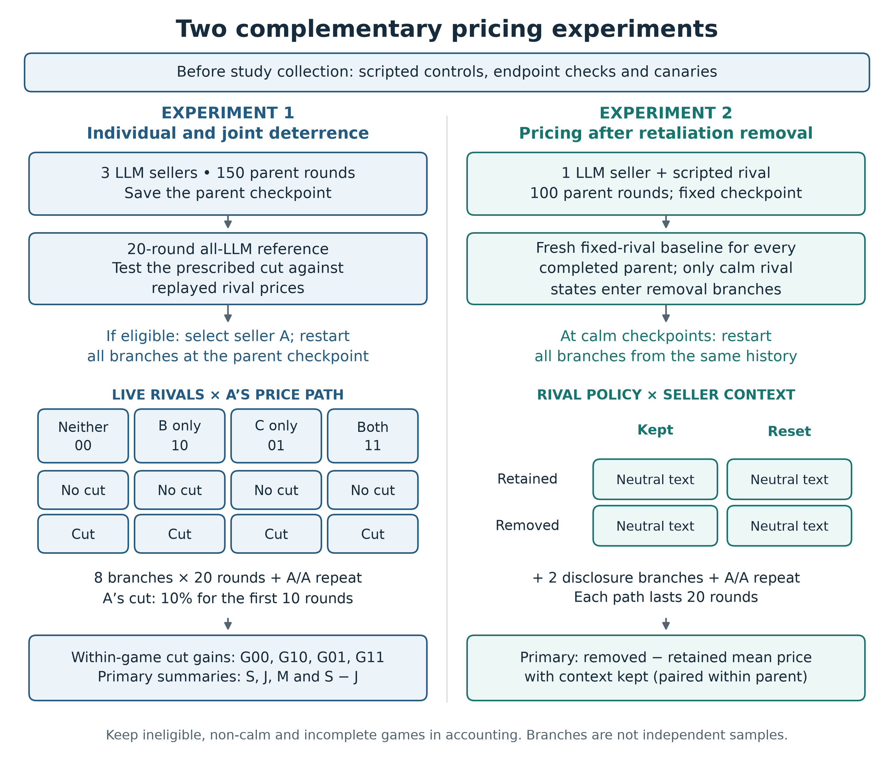
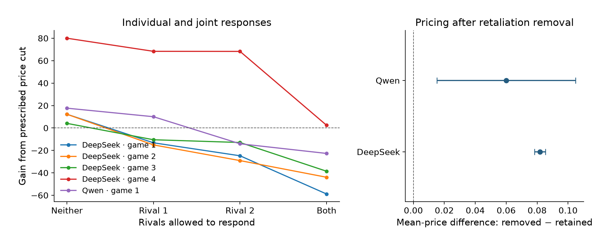

# Which Rival Makes a Price Cut Unprofitable?

Two complementary experiments examine how rival responses affect pricing.

1. **Individual and joint deterrence:** three LLM sellers, matched price-cut/no-cut continuations, and neither, either, or both rivals responding.
2. **Pricing after retaliation removal:** one LLM seller and a scripted rival; retaliation is retained or removed, crossed with retained or reset context.

The primary quantities are per-game S, J, M and paired S−J for Experiment 1, and the paired removed-minus-retained price difference for Experiment 2. Branches are not independent observations.



## Results at a glance

<!-- RESULTS:START -->
| Model | Eligible pricing games / completed | Removal effect | 98.75% interval | Calm pairs |
|---|---:|---:|---:|---:|
| DeepSeek | 4/4 | +0.0818 | [0.0783, 0.0854] | 8 |
| Qwen | 1/4 | +0.0600 | [0.0151, 0.1049] | 7 |
<!-- RESULTS:END -->

Across five eligible games, none showed the strict joint-only pattern (both individual gains positive, joint gain negative). DeepSeek's aggregate deterrence contrasts have wide intervals; Qwen has only one eligible game, so its Student-t interval is not estimable.

Removing retaliation increased the seller's mean price in the selected calm-checkpoint pairs. These are exploratory estimates, conditional on calm checkpoints—not evidence that the seller learned deterrence. The removal intervals use the planned four-model correction; the pricing-gain intervals retain the separate 16-comparison correction.



Left: each line is one eligible game, not an independent observation per branch. Right: paired removal effects with 98.75% intervals, n=8 for DeepSeek and n=7 for Qwen.

The table and result figure are generated from the bundled [verified exports](results/README.md). Rebuild them without API calls:

```bash
python -m scripts.build_readme_results
```

## Install and validate

```bash
git clone https://github.com/dshi2/llm-pricing-deterrence-audit.git
cd llm-pricing-deterrence-audit
python3 -m venv .venv
source .venv/bin/activate
python -m pip install -c requirements-tested.txt -e '.[dev]'
bash scripts/get_starter.sh
python -m pip install -c requirements-tested.txt ./starter/util ./starter/algorithmic-pricing-llms
python -m pytest -q
```

The starter is fetched at commit `d585a7b3be50366cc2bdf5789bf8add5890b2abd`.
Offline analysis and controls make no model API calls. The installation and tests are also defined in [the validation workflow](.github/workflows/tests.yml). See [VALIDATION.md](VALIDATION.md) for checks actually performed; a workflow file alone does not mean remote CI has passed.

## Rebuild this paper

```bash
python -m scripts.run_saved_report main data/experiment1/qwen38 data/experiment1/deepseek41 --out reports/experiment1 --stage pilot --planned-seeds 1 2 3 4 --label 'Frozen initial four-game sample'
python -m scripts.run_saved_report f1 data/experiment2/qwen38 data/experiment2/deepseek41 --out reports/experiment2 --label 'Frozen retaliation-removal sample'
python -m scripts.audit_f1_best_responses data/experiment2/deepseek41 --out reports/deepseek-best-response
python -m scripts.check_fallback1_controls --out reports/experiment2-controls
python -m scripts.build_paper_diagrams --out reports/designs
```

Each data path must contain that model's saved `game_*.jsonl` journals and attempt logs. Report outputs must be new folders. The `main` and `f1` CLI keys are retained for compatibility with collection records; the paper uses Experiment 1 and Experiment 2. Experiment 1 intervals retain the 16-comparison correction; Experiment 2's primary interval retains the four-model correction. With one eligible game, report the estimate without a Student-t interval.

## Reproduction status and data

This release contains the committed collection/analysis code, configurations, scripted controls, tests, plotting code and the design figure. It includes compact numerical exports for the README and plotting checks. It does **not yet include the complete frozen raw run archive**, and a fresh journal-to-paper rebuild of that archive remains pending. Export-level agreement is not a substitute for this final check. No unavailable dataset is represented as bundled.

Use a stable copy of the run folders. `run_saved_report.py` hashes inputs before/after analysis and records source hashes, git revision, Python/library versions and output hashes. Keep the manifest with the generated tables. See [REPORTING.md](REPORTING.md) for the table/figure-to-script map.

## Source and shared infrastructure

Author: **Drishti Sharma — Independent**. This standalone repository was exported from the committed sprint source recorded in `provenance/source.json`. The two paper releases retain the same tested shared `sprint` engine and compatibility modules; only the paper-specific launch notebooks are exposed. Shared reporting imports and their regression fixtures retain compatibility modules for the original source tree; these are not additional studies claimed by this paper. No uncommitted launcher edits, API credentials, live outputs or internal manuscript drafts are included.

`provenance/collection-*.tar.gz` preserves source/config snapshots at the original collection pins. Extract these separately when inspecting the original collection code; the submission tag identifies the later reporting release. Do not resume existing journals with changed collection settings.

The pinned market functions and prompt text are fetched from [the Apart starter](https://github.com/poseidon-research/collusion_hackathon), which incorporates [algorithmic_pricing_llms](https://github.com/luciasauer/algorithmic_pricing_llms). Upstream code is not vendored here. Follow upstream license terms. A license grant for the newly authored code has not yet been selected.
